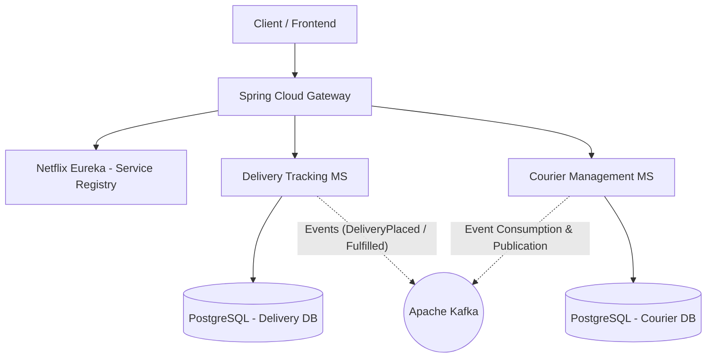
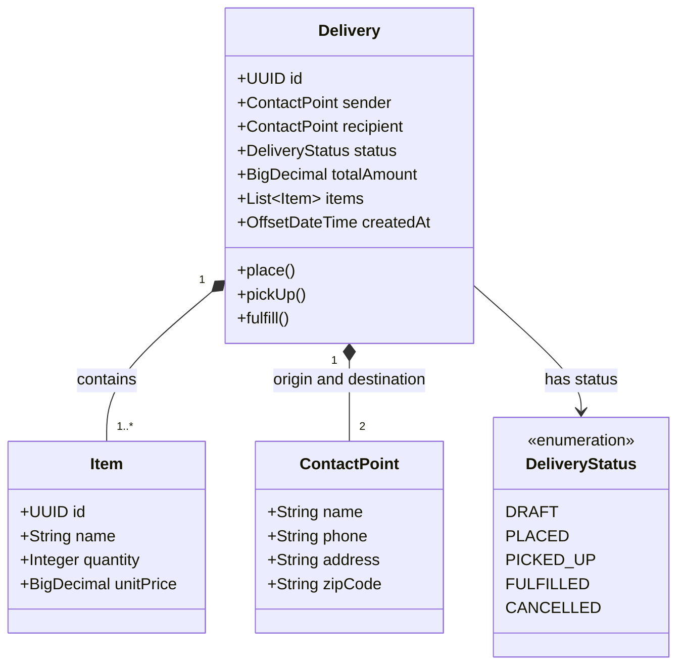

<div align="center">

[](./README.md)
[](./README.en.md)
[](./README.es.md)

[](../../releases/tag/v1.0.0)


</div>

# 🚚 AlgaDelivery — Logistics and Delivery Microservices System

This repository contains the microservices architecture for **AlgaDelivery**, a logistics and delivery tracking system
designed to apply the fundamental concepts of distributed systems, reactive architecture, and **Domain-Driven Design (
DDD)** in practice.

The project was developed during the **Ignição de Microsserviços** training by **AlgaWorks**, combining essential
theoretical foundations with immediate hands-on code implementation, focusing on building an enterprise application step
by step with service decoupling, synchronous and asynchronous communication, resilience, and automated integration
tests.

---

## 🎯 About the System and Key Concepts

**AlgaDelivery** solves logistics domain challenges by dividing responsibilities into specialized services, isolated by
**Bounded Contexts** and using individual persistence (**Database per Service**).

The application addresses and implements:

* **Domain-Driven Design (DDD):**
    * **Strategic Design:** Subdomain mapping (Core, Supporting, Generic) and bounded contexts to ensure direct
      alignment between code and the business ubiquitous language.
    * **Tactical Design:** Implementation of rich aggregates (`Delivery`), entities (`Item`), value
      objects (`ContactPoint`), domain events, and decoupled repositories.
* **Service Communication:**
    * **Synchronous (REST):** Direct calls via `Spring RestClient` for queries and operational integrations requiring
      immediate responses.
    * **Asynchronous (Event-Driven Architecture):** Publishing and consuming domain
      events (`DeliveryPlacedEvent`, `DeliveryPickedUpEvent`, `DeliveryFulfilledEvent`) using **Apache Kafka** and *
      *Spring for Apache Kafka**.
* **Infrastructure & Resilience:**
    * Centralized routing and edge security with **Spring Cloud Gateway**.
    * Dynamic instance registration and discovery with **Netflix Eureka** (*Service Registry*).
    * Fault tolerance with **Resilience4j** and **Spring Cloud Circuit Breaker** (*Circuit Breaker* and *Retry*
      patterns).
    * Local database and messaging environment provisioning via **Docker Compose**.
* **Quality & Testing:**
    * Automated integration tests covering REST API scenarios and domain workflows with **JUnit 5** and **REST Assured
      **.

---

## 📁 Project Structure

```text
aw-delivery-ms/
├── backend/                  # Microservices source code (Spring Boot)
├── .gitignore                # Git ignore rules (Java, IDEs, Node)
├── LICENSE                   # Repository License (MIT)
├── README.md                 # Main Documentation (Portuguese)
├── README.en.md              # Documentation (English)
└── README.es.md              # Documentation (Spanish)
```

---

## 🏛️ Solution Architecture



### 📐 Domain Class Diagram (DDD)



### 🧩 Ecosystem Components

* **`Spring Cloud Gateway`:** Single point of entry for the application, responsible for routing and securing requests
  to internal services.
* **`Netflix Eureka`:** Service registry and dynamic discovery server for microservices.
* **`Delivery Tracking Service`:** Microservice responsible for delivery creation, status transitions, and detailed
  tracking.
* **`Courier Management Service`:** Microservice responsible for courier management, freight allocation, and
  availability.
* **`Apache Kafka`:** Distributed event streaming platform for asynchronous, decoupled event propagation.

---

## 🛠️ Technologies and Tools

* **Language & Frameworks:** Java 17+, Spring Boot 3+, Spring Cloud (Gateway, Eureka)
* **Architecture & Design:** Domain-Driven Design (DDD), Event-Driven Architecture (EDA)
* **Messaging & Communication:** Apache Kafka, Spring for Apache Kafka, Spring RestClient
* **Resilience:** Resilience4j, Spring Cloud Circuit Breaker
* **Data Persistence:** Spring Data JPA, PostgreSQL (Database per Service)
* **Containers & Environment:** Docker, Docker Compose
* **Automated Testing:** JUnit 5, REST Assured

<br />

<div align="center">

    
   
    
 

</div>

---

## 📌 Next Steps (Roadmap)

| Version                                                                                                                | Description                                                                                                                                 |
|:-----------------------------------------------------------------------------------------------------------------------|:--------------------------------------------------------------------------------------------------------------------------------------------|
| [](../../releases/tag/v1.0.0) | Complete baseline of the AlgaDelivery training: Logistics Microservices, DDD, Kafka, Gateway, Eureka, Resilience, and REST Assured testing. |
| [](../../releases/tag/v2.0.0)         | Development of a web interface (Front-end Dashboard) for real-time delivery map and status tracking.                                        |
| [](../../releases/tag/v3.0.0)         | Infrastructure deployment on Kubernetes (K8s) orchestrated containers and CI/CD pipeline via GitHub Actions.                                |

---

## 🍃 About

Theory and practical project developed during the **Ignição Microsserviços** course on the 🍃 **AlgaWorks** platform.

---

## 👤 Author

Developed by **Ivan Ferreira**.

Copyright © 2026 Ivan Ferreira. All rights reserved.

---

<div align="center">

[](./README.md)

</div>