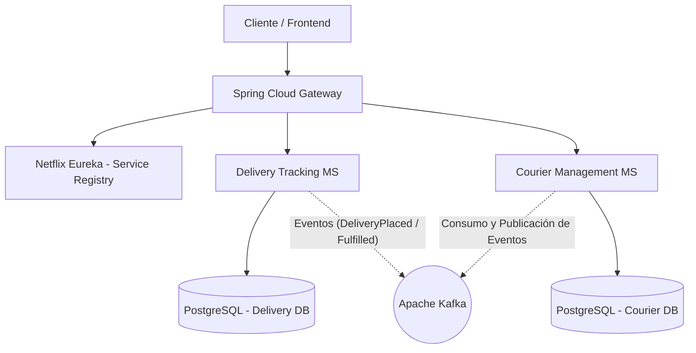
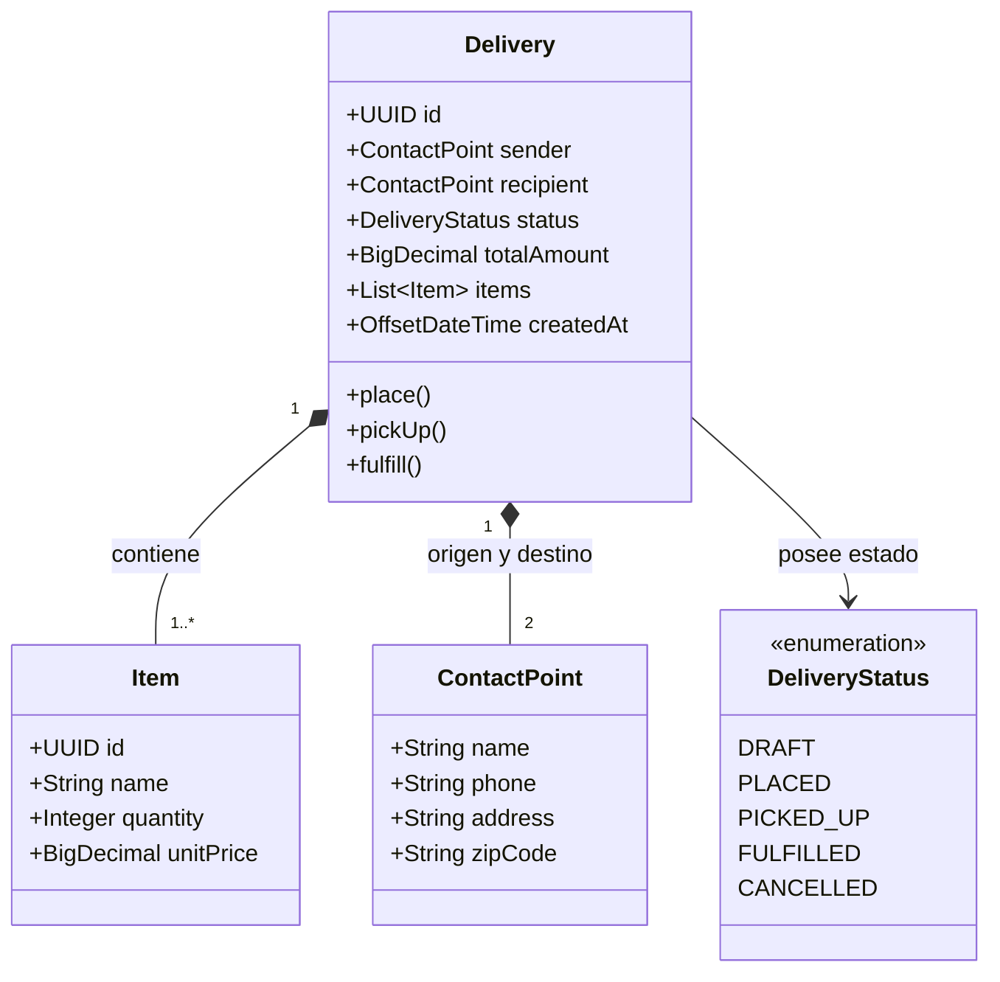

<div align="center">

[](./README.md)
[](./README.en.md)
[](./README.es.md)

[](../../releases/tag/v1.0.0)


</div>

# 🚚 AlgaDelivery — Sistema de Logística y Envíos en Microservicios

Este repositorio contiene la arquitectura de microservicios de **AlgaDelivery**, un sistema de logística y seguimiento
de envíos diseñado para aplicar en la práctica los conceptos fundamentales de sistemas distribuidos, arquitectura
reactiva y **Domain-Driven Design (DDD)**.

El proyecto fue desarrollado durante la capacitación **Ignição de Microsserviços** de **AlgaWorks**, alineando la base
teórica esencial con la implementación práctica inmediata en código, enfocándose en la construcción gradual de una
aplicación empresarial con desacoplamiento de servicios, comunicación síncrona y asíncrona, resiliencia y pruebas de
integración automatizadas.

---

## 🎯 Sobre el Sistema y Conceptos Clave

**AlgaDelivery** resuelve los desafíos del dominio de logística dividiendo responsabilidades en servicios
especializados, aislados por contextos delimitados (*Bounded Contexts*) y con persistencia de datos propia (*Database
per Service*).

La aplicación aborda e implementa:

* **Domain-Driven Design (DDD):**
    * **Diseño Estratégico:** Mapeo de subdominios (Core, Soporte, Genérico) y contextos delimitados para garantizar
      alineación directa entre el código y el lenguaje ubicuo del negocio.
    * **Diseño Táctico:** Implementación de agregados ricos (`Delivery`), entidades (`Item`), objetos de
      valor (`ContactPoint`), eventos de dominio y repositorios desacoplados.
* **Comunicación entre Servicios:**
    * **Síncrona (REST):** Llamadas directas vía `Spring RestClient` para consultas e integraciones operativas que
      requieren respuesta inmediata.
    * **Asíncrona (Event-Driven Architecture):** Publicación y consumo de eventos de
      dominio (`DeliveryPlacedEvent`, `DeliveryPickedUpEvent`, `DeliveryFulfilledEvent`) utilizando **Apache Kafka** y *
      *Spring for Apache Kafka**.
* **Infraestructura y Resiliencia:**
    * Enrutamiento centralizado y seguridad de borde con **Spring Cloud Gateway**.
    * Descubrimiento y registro dinámico de instancias con **Netflix Eureka** (*Service Registry*).
    * Tolerancia a fallos con **Resilience4j** y **Spring Cloud Circuit Breaker** (patrones *Circuit Breaker* y
      *Retry*).
    * Aprovisionamiento del entorno local de base de datos y mensajería mediante **Docker Compose**.
* **Calidad y Pruebas:**
    * Pruebas de integración automatizadas cubriendo los escenarios de las REST APIs y flujos de dominio con **JUnit 5**
      y **REST Assured**.

---

## 📁 Estructura del Proyecto

```text
aw-delivery-ms/
├── backend/                  # Código fuente de los microservicios (Spring Boot)
├── .gitignore                # Reglas de ignorados de Git (Java, IDEs, Node)
├── LICENSE                   # Licencia del repositorio (MIT)
├── README.md                 # Documentación principal (Portugués)
├── README.en.md              # Documentation (Inglés)
└── README.es.md              # Documentación (Español)
```

---

## 🏛️ Arquitectura de la Solución



### 📐 Diagrama de Clases del Dominio (DDD)



### 🧩 Componentes del Ecosistema

* **`Spring Cloud Gateway`:** Punto único de entrada de la aplicación, encargado de redirigir y proteger las peticiones
  hacia los servicios internos.
* **`Netflix Eureka`:** Servidor de registro y descubrimiento dinámico de instancias de microservicios.
* **`Delivery Tracking Service`:** Microservicio responsable de la creación, transiciones de estado y seguimiento
  detallado de envíos.
* **`Courier Management Service`:** Microservicio responsable de la gestión de repartidores, asignación de fletes y
  disponibilidad.
* **`Apache Kafka`:** Bus distribuido para la propagación de eventos asíncronos y desacoplados.

---

## 🛠️ Tecnologías y Herramientas

* **Lenguaje y Frameworks:** Java 17+, Spring Boot 3+, Spring Cloud (Gateway, Eureka)
* **Arquitectura y Diseño:** Domain-Driven Design (DDD), Event-Driven Architecture (EDA)
* **Mensajería y Comunicación:** Apache Kafka, Spring for Apache Kafka, Spring RestClient
* **Resiliencia:** Resilience4j, Spring Cloud Circuit Breaker
* **Persistencia de Datos:** Spring Data JPA, PostgreSQL (Database per Service)
* **Contenedores y Entorno:** Docker, Docker Compose
* **Pruebas Automatizadas:** JUnit 5, REST Assured

<br />

<div align="center">

    
   
    
 

</div>

---

## 📌 Próximos Pasos (Hoja de Ruta)

| Versión                                                                                                                    | Descripción                                                                                                                                            |
|:---------------------------------------------------------------------------------------------------------------------------|:-------------------------------------------------------------------------------------------------------------------------------------------------------|
| [](../../releases/tag/v1.0.0) | Línea base completa de la capacitación AlgaDelivery: Microservicios de Logística, DDD, Kafka, Gateway, Eureka, Resiliencia y Pruebas con REST Assured. |
| [](../../releases/tag/v2.0.0)             | Desarrollo de una interfaz web (Dashboard Front-end) para el seguimiento del mapa y estado de envíos en tiempo real.                                   |
| [](../../releases/tag/v3.0.0)             | Despliegue de la infraestructura en contenedores orquestados mediante Kubernetes (K8s) y flujo de CI/CD vía GitHub Actions.                            |

---

## 🍃 Sobre

Teoría y proyecto práctico desarrollado durante el curso **Ignição Microsserviços** de la plataforma 🍃 **AlgaWorks**.

---

## 👤 Autor

Desarrollado por **Ivan Ferreira**.

Copyright © 2026 Ivan Ferreira. Todos los derechos reservados.

---

<div align="center">

[](./README.md)

</div>