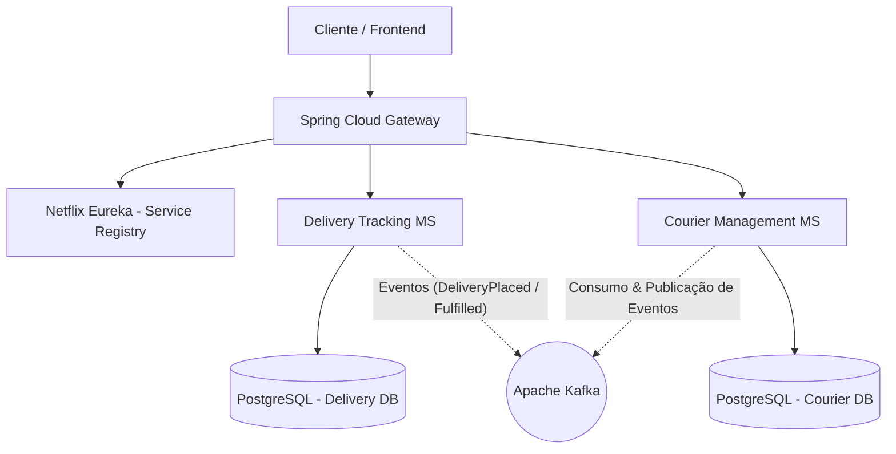

# 🚚 AlgaDelivery — Sistema de Logística e Entregas em Microsserviços

Este repositório contém a arquitetura de microsserviços do **AlgaDelivery**, um sistema de logística e rastreamento de
entregas projetado para aplicar na prática os conceitos fundamentais de sistemas distribuídos, arquitetura reativa e *
*Domain-Driven Design (DDD)**.

O projeto foi desenvolvido ao longo do treinamento **Ignição de Microsserviços** da **AlgaWorks**, que alinha o
embasamento teórico essencial à implementação prática imediata no código, focando na construção gradual de uma aplicação
corporativa com desacoplamento de serviços, comunicação síncrona e assíncrona, resiliência e testes de integração
automatizados.

---

## 🎯 Sobre o Sistema e Conceitos-Chave

O **AlgaDelivery** resolve os desafios do domínio de logística dividindo responsabilidades em serviços especializados,
isolados por contextos delimitados (*Bounded Contexts*) e com persistência de dados própria (*Database per Service*).

A aplicação aborda e implementa:

* **Domain-Driven Design (DDD):**
    * **Design Estratégico:** Mapeamento de subdomínios (Core, Suporte, Genérico) e contextos delimitados para garantir
      alinhamento direto entre o código e a linguagem ubíqua do negócio.
    * **Design Tático:** Implementação de agregados ricos (`Delivery`), entidades (`Item`), objetos de
      valor (`ContactPoint`), eventos de domínio e repositórios desacoplados.
* **Comunicação entre Serviços:**
    * **Síncrona (REST):** Chamadas diretas via `Spring RestClient` para consultas e integrações operacionais que exigem
      resposta imediata.
    * **Assíncrona (Event-Driven Architecture):** Publicação e consumo de eventos de
      domínio (`DeliveryPlacedEvent`, `DeliveryPickedUpEvent`, `DeliveryFulfilledEvent`) utilizando **Apache Kafka** e *
      *Spring for Apache Kafka**.
* **Infraestrutura e Resiliência:**
    * Roteamento centralizado e segurança de borda com **Spring Cloud Gateway**.
    * Descoberta e registro dinâmico de instâncias com **Netflix Eureka** (*Service Registry*).
    * Tolerância a falhas com **Resilience4j** e **Spring Cloud Circuit Breaker** (padrões *Circuit Breaker* e *Retry*).
    * Provisionamento do ambiente local de banco de dados e mensageria via **Docker Compose**.
* **Qualidade e Testes:**
    * Testes de integração automatizados cobrindo os cenários das REST APIs e fluxos de domínio com **JUnit 5** e **REST
      Assured**.

---

## 🏛️ Arquitetura da Solução

### 🧩 Componentes do Ecossistema

* **`Spring Cloud Gateway`:** Ponto único de entrada da aplicação, encarregado de redirecionar e proteger as requisições
  para os serviços internos.
* **`Netflix Eureka`:** Servidor de registro e descoberta dinâmica de instâncias dos microsserviços.
* **`Delivery Tracking Service`:** Microsserviço responsável pela criação, transições de status e acompanhamento
  detalhado das entregas.
* **`Courier Management Service`:** Microsserviço responsável pela gestão de entregadores, alocação de fretes e
  disponibilidade.
* **`Apache Kafka`:** Barramento distribuído para propagação de eventos assíncronos e desacoplados.

---

## 🛠️ Tecnologias e Ferramentas

* **Linguagem & Frameworks:** Java 17+, Spring Boot 3+, Spring Cloud (Gateway, Eureka)
* **Arquitetura & Design:** Domain-Driven Design (DDD), Event-Driven Architecture (EDA)
* **Mensageria & Comunicação:** Apache Kafka, Spring for Apache Kafka, Spring RestClient
* **Resiliência:** Resilience4j, Spring Cloud Circuit Breaker
* **Persistência de Dados:** Spring Data JPA, PostgreSQL (Database per Service)
* **Containers & Ambiente:** Docker, Docker Compose
* **Testes Automatizados:** JUnit 5, REST Assured

 

    
   
    
 

---

## 📌 Próximos Passos (Roadmap)

| Versão                                                                                                                   | Descrição                                                                                                                                       |
|:-------------------------------------------------------------------------------------------------------------------------|:------------------------------------------------------------------------------------------------------------------------------------------------|
|  | Baseline completo do treinamento AlgaDelivery: Microsserviços de Logística, DDD, Kafka, Gateway, Eureka, Resiliência e Testes com REST Assured. |
|            | Desenvolvimento de uma interface web (Dashboard Front-end) para acompanhamento do mapa e status de entregas em tempo real.                      |
|            | Implantação da infraestrutura em contêineres orquestrados via Kubernetes (K8s) e esteira de CI/CD via GitHub Actions.                           |

---

## 🍃 Sobre

Teoria e projeto prático desenvolvido durante o curso **Ignição Microsserviços** da plataforma 🍃 **AlgaWorks**.

---

## 👤 Autor

Desenvolvido por **Ivan Ferreira**.

Copyright © 2026 Ivan Ferreira. Todos os direitos reservados.